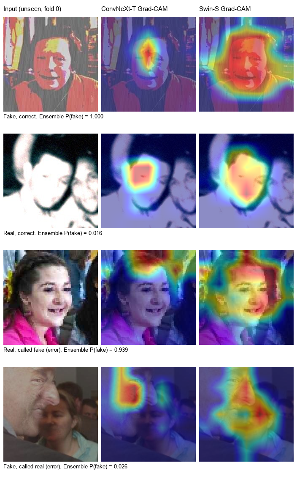

# Deepfake image detection: ConvNeXt-Tiny + Swin-S ensemble

Entry for the Deepfake ML Hackathon (IIIT Bangalore). Private repository. All rights reserved.

A binary classifier for 224x224 face images (label 0 = real, 1 = AI-manipulated). The model is an equal-logit-mean ensemble of ConvNeXt-Tiny and Swin-S, both fine-tuned from torchvision ImageNet-1K weights on the 7,000 provided training images only, with a noise-tolerant generalized cross entropy (GCE, q = 0.7) loss and mild corruption augmentation. Inference takes about 31 s for 3,000 images on an RTX 5060 Ti. The final score is a sigmoid of the mean of the two logits, thresholded at 0.5.

## Results

All accuracy numbers below are development numbers. They come from five cross-validation folds that were reused for every design decision, so they are optimistic and are not a test-set estimate. J04 is our own local robustness proxy, not the organisers' formula.

| Metric (shipped pair, development) | Value |
|---|---:|
| AUC-ROC, mean of 5 out-of-fold sets | 0.907 |
| Pooled out-of-fold F1 at threshold 0.5 (5,950 images) | 0.870 |
| J04 (original AUC + 0.4 x corruption AUC), mean of 5 folds | 1.268 |
| Weights file | 307,262,591 bytes |
| GPU inference, 3,000 images, RTX 5060 Ti | about 31 s (29.9 to 30.2 s measured wall time over 3 runs) |
| CPU inference, 3,000 images | about 134 s, scores within 3.4e-6 of GPU, no label flips |
| T4 inference, 3,000 images | about 138 s, projected (4.5x assumed factor), not measured |

## Architecture

| | Member A | Member B |
|---|---|---|
| Backbone | ConvNeXt-Tiny | Swin-S |
| Parameters | 28.6 M | 49.6 M |
| GMACs at 224 | 4.46 | 8.74 |
| Initial weights | torchvision ImageNet-1K | torchvision ImageNet-1K |
| Head | one linear unit | one linear unit |

```
image -> ImageNet normalise -+-> ConvNeXt-T -> z_A -+
                             |                      +-> (z_A + z_B) / 2 -> sigmoid -> P(fake)
                             +-> Swin-S ----> z_B -+
```

Both members run in FP32 at inference. The convolutional and windowed-attention members make partly different errors; on the five out-of-fold sets the pair was above both members alone on every fold. No face detector or extra encoder is used.

## Quickstart

```
pip install -r requirements.txt
python inference_script.py --test_dir ./test/images/ --weights model_weights.pt --output predictions.csv
```

- Add `--device cpu` to force CPU. The default uses CUDA when available. With no CUDA and no flag, the script falls back to CPU only if `release_policy.json` is next to the weights and enables it for this exact weights file.
- `--test_dir` is a flat folder of images. `deepfake_core_x1.py` must sit next to `inference_script.py`.
- `--batch_size`, `--workers` and `--threshold` are accepted but ignored with a warning (batch 64, no workers, threshold 0.5), so output is reproducible.
- An image that cannot be decoded stops the run with its filename; no placeholder score is written.
- Output CSV header: `image_id,label,confidence` (`confidence` is the probability of fake, `label` is 1 if it is at least 0.5).
- Pinned: Python 3.10, torch 2.7.1, torchvision 0.22.1, numpy 2.2.6, Pillow 11.2.1. For a GPU, install the CUDA build of torch matching your driver (CUDA 12.8 was used).

## Model weights

`model_weights.pt` is published as a GitHub Release asset of this repository, v1.0. It is not stored in the git tree.

- Size: 307,262,591 bytes
- SHA-256: `01bbdc959f23213751d126e595b4f390d7239575a80c4800b8e62ddab8825306`

Verify with `sha256sum model_weights.pt`. The TensorFlow SavedModel is a separate asset, `sm_ensemble.zip` (see `tensorflow/README.md`).

## Training reproduction

Code is in `training/`. The recipe is frozen in `training/experiments/final_protocol_v3.json`:

| Setting | Value |
|---|---|
| Loss | GCE, q = 0.7 |
| Optimiser | AdamW, weight decay 0.01 (not on biases and 1-D parameters) |
| Learning rate | backbone 1e-4, head 1e-3 |
| Schedule | 2 warm-up epochs, then cosine to zero; 20 epochs, batch 32 |
| EMA | 0.999 (EMA weights used for evaluation) |
| Augmentation | horizontal flip p = 0.5; with p = 0.35 one extra mild/moderate corruption (JPEG, resolution, photometric, tone, occlusion, noise) |
| Precision | mixed precision for training, FP32 for inference |
| Seed | 17 per member |

Each member starts from torchvision ImageNet-1K weights and trains on all 7,000 provided images. Command (Linux, frozen protocol, from `training/`): `python scripts/train_final_v3.py --root . --execute-frozen`; `--dry-run` checks the setup. Recorded fit times: ConvNeXt-T 401.9 s, Swin-S 771.2 s. Training data is not included, and GPU training is not bit-reproducible across hardware. See `training/README.md`.

## Robustness evaluation

Robustness is measured with a local proxy: J04 = original-image AUC + 0.4 x R, where R is a weighted mean AUC over 51 degraded variants of the validation images. The variants fall in eight families: JPEG, resolution, photometric, tone, occlusion, noise, convolution (blur) and geometric. Families have equal weight and severity levels are weighted 0.50 / 0.35 / 0.15. Blur and geometric families are excluded from training augmentation. Two corruption suites were used (v1 for the main comparisons, an independent v2 registry for later checks). For the shipped pair, R is 0.903 against an original AUC of 0.907. Weakest conditions: strong pixelation (AUC 0.750), strong Gaussian blur (0.850), colour inversion (0.858).



Grad-CAM on both members for development-pool images; see `docs/REPORT.md` section 7 for the method and its limits.

## What did not work

All differences are in J04 against the shipped pair on the development folds. Fold-to-fold retraining variance is about 0.004.

- T1, horizontal-flip test-time augmentation: mean +0.0009 against a required +0.001; extra inference cost 57.2 s vs 30.6 s. Not adopted.
- S1, real-only pseudo-fake images: probe AUC 0.576, bar was 0.60. Stopped.
- Q2, EfficientNet-B0 as a third member: mean -0.0003 vs required +0.002; 2/5 folds positive.
- R1, blur augmentation and a regional head: -0.0006 and -0.0017.
- P22, ImageNet-21k/22k initial weights: negative on fold 1 for every member (pair means -0.0012 to -0.0078).
- P23, SAM optimiser: mean +0.0009 vs bar +0.004; 2/5 folds positive.
- P24, cascaded corruption augmentation: mean +0.0023 vs bar +0.004; 3/5 folds positive, worst fold -0.0035.

Details are in `docs/REPORT.md` section 5 and `experiments/README.md`.

## Limitations

- Development numbers are selection-exposed and optimistic; expect lower on unseen data.
- Transfer to generators absent from the training set is untested.
- Robustness is measured only against our own corruptions; strong blur and pixelation are weak spots.
- About 8 to 10 percent of images in each fold are confidently wrong for both members, consistent with label noise or ambiguity.
- T4 timing is projected, not measured. Training hyperparameters were fixed from a standard recipe and not searched.
- The Grad-CAM randomisation sanity check failed its second criterion (see the report).

## Repository structure

```
.
|-- README.md
|-- inference_script.py        entry point
|-- deepfake_core_x1.py        model construction, preprocessing, prediction
|-- requirements.txt
|-- release_policy.json        enables the verified CPU fallback (keep next to the weights)
|-- training/                  training, screening and release-check code, frozen protocols
|   |-- scripts/  experiments/  README.md  REDACTIONS.md
|-- experiments/               follow-up experiments P22-P24 (not adopted)
|-- tensorflow/                SavedModel inference, export and equivalence scripts
`-- docs/
    |-- technical-report.pdf   full report
    |-- short-report.pdf       short report
    |-- REPORT.md              report source text
    |-- assets/                Grad-CAM figure
    `-- training-logs/         final-refit curves and summaries (JSON)
```

## Rules compliance

- Only the provided training data was used. No external deepfake data.
- Initial weights are supervised ImageNet-pretrained torchvision backbones only: no deepfake-specific detectors, no CLIP/DINO-style models, no face or landmark models.
- No test-time training or adaptation; test images were never used for training.

## Citation

Deepfake ML Hackathon, IIIT Bangalore (2026).
