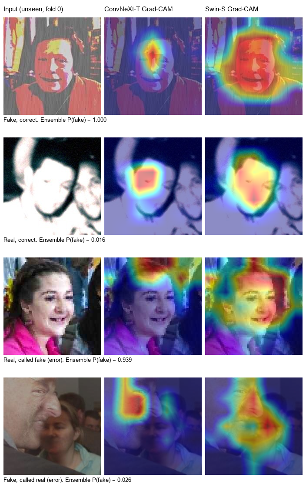

# Real vs AI-manipulated face classification with a two-model ensemble (ConvNeXt-Tiny + Swin-S)

Technical report, v4 (12 Nov 2026 IST). Hackathon: Deepfake ML Hackathon, IIIT Bangalore.

**Reading guide.** All accuracy numbers here are *development* numbers. They come from five cross-validation folds that were used repeatedly to choose the design. They are optimistic. They are not a test-set estimate. J04 is a local proxy, not the judges' formula. 

---

## 1. Problem and approach rationale

**Task.** Given a 224x224 face image, output the probability that it is AI-manipulated (label 1) or real (label 0). The score is AUC-ROC on that probability, so ranking matters more than the 0.5 threshold.
**Data limits.** Only the provided 7,000 labelled images may be used. Pre-trained ImageNet models are allowed. Deepfake-specific pre-trained detectors and external training data are not.
**Scoring (organiser rubric).** 50 points accuracy (AUC), 20 efficiency (T4 inference time), 20 robustness (AUC stability over undisclosed test variants), 10 documentation.
**Why this approach.**
1. *The hidden test set mixes generation methods.* A model that learns one generator's artefacts may fail on others. We therefore avoided hand-built artefact detectors and fine-tuned strong general image backbones end to end on the full image.
2. *The README says the training labels contain noise and ambiguity.* We use a noise-tolerant loss (generalized cross entropy, GCE) instead of plain cross entropy.
3. *Two architectures, not one.* A convolutional network (ConvNeXt-Tiny) and a shifted-window transformer (Swin-S) make different errors. Averaging their logits was worth more than a second seed of the same network in our tests (Section 5).
4. *Robustness is 20 points.* The training augmentation adds mild JPEG, resolution, photometric, tone, occlusion and noise corruptions. We track a local robustness proxy over 51 degraded variants (Section 6).
5. *Efficiency is 20 points.* Only runs under 5 minutes on a T4 earn the full 20. We kept the pair small (13.2 GMACs combined) and rejected larger candidates on timing as well as accuracy.
**Rule we set ourselves.** Initial weights come only from torchvision's supervised ImageNet-1K release. No CLIP, DINO, face or landmark models. No external data. Test images are never used.
---

## 2. Data and splits

**Training set.** 7,000 labelled JPEGs, 224x224, pre-aligned face crops: 3,522 fake and 3,478 real.
**Split design.** Many images share a source (the same person, photo or generator run). A random split would put near-duplicates on both sides and inflate scores. We first grouped images by source similarity: 6,599 groups, 388 of them with more than one image, largest group size 3. Groups are never split across folds.
The split has two parts:

| Part | Images | Fake | Real | Use |
|---|---:|---:|---:|---|
| Development pool, fold 0 | 1,191 | 599 | 592 | cross-validation |
| fold 1 | 1,190 | 599 | 591 | cross-validation |
| fold 2 | 1,190 | 599 | 591 | cross-validation |
| fold 3 | 1,190 | 599 | 591 | cross-validation |
| fold 4 | 1,189 | 598 | 591 | cross-validation |
| Holdout | 1,050 | 528 | 522 | spent (one readout of the pre-final P-only models) |


The pool is 5,950 images (five folds). Allocation was deterministic, largest group first, with class balance as the target. Seed 20261031.
**Honest caveats.**
- Similarity groups are a proxy for "same source". They do not certify that identities or generators are disjoint between folds.- The holdout was already spent: it received one readout from the earlier full-pool fits, and the final shipped weights were then refit on all 7,000 images, so the holdout is training data for them. We do not report a holdout number.- **No JPEG-format shortcut.** We audited the 5,950 development-pool files at header level (no pixels decoded). All were written by one pipeline: JFIF, 224x224 RGB, baseline, 4:2:0, IJG quality exactly 92, identical tables, no EXIF/ICC/comment. Real and fake do not differ in any of these. The strongest single feature, file size in bytes, has out-of-fold AUC 0.518 (folds 0.502 to 0.533), which reflects image detail, not format. No feature alone exceeds 0.60. The audit cannot say anything about the hidden test files' encoding, which we did not open.- All five pool folds were reused for every design decision (Section 5). Reported development AUC is therefore optimistic.

---

## 3. Architecture

Two image classifiers, each producing one logit for "fake". The final score is the equal mean of the two logits, passed through a sigmoid.
| Item | Member A | Member B |
|---|---|---|
| Backbone | ConvNeXt-Tiny (convolutional) | Swin-S (shifted-window transformer) |
| Parameters (M) | 28.6 | 49.6 |
| GMACs at 224 | 4.46 | 8.74 |
| Initial weights | torchvision ImageNet-1K | torchvision ImageNet-1K |
| Head | original classifier replaced by one linear unit | original head replaced by one linear unit |
| Seed | 17 | 17 |


Input: full face image, RGB, 224x224, ImageNet mean/std normalisation. No face detector, no extra encoder. Non-224 inputs are bilinearly resized.
Fusion and inference: both members run in FP32 (TF32 off). Logits are averaged with equal weights in FP64, then sigmoid, temperature 1. Label is 1 if confidence is at least 0.5. Output is `image_id,label,confidence`.
```mermaid
flowchart LR
  I[224x224 RGB face] --> N[ImageNet normalisation]
  N --> A[ConvNeXt-Tiny + linear head] --> LA[logit z_A]
  N --> B[Swin-S + linear head] --> LB[logit z_B]
  LA --> M[mean: z = (z_A + z_B) / 2]
  LB --> M
  M --> S[sigmoid] --> P[confidence P-fake; label = P >= 0.5]
```

ASCII version:

```
image -> normalise -+-> ConvNeXt-T -> z_A -+
                    |                      +-> (z_A+z_B)/2 -> sigmoid -> P(fake)
                    +-> Swin-S ----> z_B -+
```

**Why this pair.** The two members differ in design (local convolutions vs windowed attention), and their errors only partly overlap: the hardest 10% of images in each overlap with Jaccard 0.60 to 0.66 across folds.On the five out-of-fold sets, the pair's AUC was above both members alone on every fold (fold 3 only by 0.0001: .8925 vs .8924 for Swin-S), e.g. fold 0: ConvNeXt-T .9057, Swin-S .9074, pair .9108.Combined size of the shipped weights is 307,262,591 bytes, far below the 5 GB limit.
**Last experiment (P22), no change.** We tried ImageNet-21k/22k starting weights at the same architectures and recipe. No member beat the ImageNet-1K start on both screening folds, so nothing changed: the shipped model is the final-v3 pair above, with ImageNet-1K initial weights (Section 5.2).
---

## 4. Training pipeline

All settings are identical for both members, except the architecture. Recipe frozen on 1 Nov 2026 and unchanged for the shipped model.
| Setting | Value |
|---|---|
| Loss | Generalized cross entropy, q = 0.7 |
| Optimiser | AdamW, weight decay 0.01 (not applied to biases and 1-D parameters) |
| Learning rate | backbone 1e-4, new head 1e-3 |
| Schedule | 2 warm-up epochs, then cosine decay to zero |
| Epochs | 20 (fixed; last epoch used, no best-checkpoint picking) |
| Batch size | 32 |
| EMA | decay 0.999 on weights; EMA weights used for evaluation |
| Precision | mixed precision (fp16) for training; FP32 for evaluation and inference |
| Seed | 17 per member |
| Initial weights | torchvision ImageNet-1K |


**Loss.** For logit z and label y, let p be the model probability of the true class. GCE is (1 - p^q) / q with q = 0.7. It behaves like cross entropy for easy examples but down-weights examples the model finds very unlikely, which limits the damage from wrong labels.
**Augmentation ("A1-light").** Each training view is flipped horizontally with probability 0.5. With probability 0.35 it also gets one extra corruption from: JPEG, resolution, photometric, tone, occlusion, noise. Severity is mild with probability 0.6, moderate with 0.4. Blur/convolution and geometric families are excluded from training augmentation. Randomness is seeded by image ID, epoch and seed.
**Fitting stages.**
1. During development, each member was fit on four of five pool folds and scored on the fifth (out-of-fold).
2. Two full-pool fits (5,950 images) fed one holdout readout.
3. The shipped weights are refit on all 7,000 images with the same recipe, from the original ImageNet weights. No fine-tuning chain from development checkpoints.
**Compute.** Development fits on one RTX 5060 Ti took about 7.9 min (ConvNeXt-T) and 9.9 min (Swin-T) each, including validation scoring.The final all-data fits (7,000 images, 20 epochs, seed 17) took 401.9 s wall time for ConvNeXt-T and 771.2 s for Swin-S (about 13 min). The GPU model is not named in these receipts.
**Threshold.** Fixed at 0.5. It was not tuned. The confidence is a ranking score and is not claimed to be calibrated.
---

## 5. Hyperparameter and design evidence

Every choice below was tested on the same five pool folds (some only on folds 0-1). Deltas are mean differences in the J04 proxy (Section 6). Folds are noisy: the standard deviation of per-fold differences was about 0.004, so the standard error of a 5-fold mean is about 0.002.
### 5.1 Main ablation (choices that made it into the final model)

| Step | Comparison | Result | Folds |
|---|---|---|---|
| E1 backbone | ConvNeXt-T vs Swin-T vs EffNetV2-S vs EffNet-B0, same recipe | original AUC .89990 / .89414 / .88989 / .88588; J04 1.25834 / 1.24941 / 1.24396 / 1.23667 | 0-1 |
| P1 ensemble | ConvNeXt + Swin-T vs ConvNeXt alone | ΔJ04 +0.00977 (95% CI [+0.0058, +0.0139]), positive on 5/5 folds | 0-4 |
| P1 control | ConvNeXt, two seeds vs one seed | ΔJ04 +0.00611 | 0-4 |
| P2 loss | GCE q=0.7 vs plain BCE (ConvNeXt) | ΔJ04 +0.01526; original AUC +0.01109 | 0-1 |
| P2 loss | label smoothing 0.1 vs BCE | ΔJ04 -0.00203 (rejected) | 0-1 |
| L1 | GCE pair vs BCE pair | ΔJ04 +0.00954, positive on 5/5 folds | 0-4 |
| L1 | GCE pair vs ConvNeXt-GCE alone | ΔJ04 +0.00422, 5/5 folds | 0-4 |
| L1 | mixed pair (ConvNeXt-GCE + Swin-BCE) vs ConvNeXt-GCE | ΔJ04 +0.00149, 2/5 folds (failed gate) | 0-4 |
| X1 | Swin-S vs Swin-T as the second member | screen ΔJ04 +0.0090 (folds 0-1), confirmation +0.0073 (folds 0-2) | 0-2 |
| X1 | final pair ConvNeXt-T + Swin-S vs ConvNeXt-T + Swin-T | ΔJ04 +0.00333, 95% CI [+0.0003, +0.0064], 4/5 folds positive; original AUC +0.00236 | 0-4 |


Reading the table: the largest single gain is the GCE loss (+0.015). The second is combining two architectures (+0.010 over one network, +0.004 over two seeds of one network). Moving from Swin-T to Swin-S added a smaller +0.003. The shipped pair has development AUC 0.9071 and J04 1.2684 (mean over five folds).
The hyperparameters in Section 4 (learning rates, 20 epochs, batch 32, EMA, weight decay) were **not** searched. They were fixed in the first experiment (E1) from standard fine-tuning practice and kept for every later comparison, so that differences came from architecture, loss and ensembling only. We have no ablation for them and do not claim they are optimal.

### 5.2 Things we tried that did not help (kept as negative results)

| Step | What | Result | Verdict |
|---|---|---|---|
| X1 | ConvNeXt-S as member | ΔJ04 -0.0081 (screen) | rejected |
| X1 | ConvNeXt-B as member | ΔJ04 -0.0048 (screen) | rejected |
| X1 | 3- and 4-member ensembles | +0.0019 and +0.0022, only 3/5 folds positive | rejected |
| R1 | blur augmentation; regional head | ΔJ04 -0.0006 and -0.0017 | rejected at screen |
| T1 | horizontal-flip test-time augmentation | mean ΔJ04 +0.00090 vs required +0.001; 5/5 folds ≥ 0; CI [-0.00007, +0.00189]; extra inference cost 57.2 s vs 30.6 s worst case | failed its pre-set gate by 0.0001; not adopted |
| D1 | extra augmentation if variant suite lagged | trigger condition not met | not run |
| S1 | real-only pseudo-fake images (probe) | probe AUC 0.5758, bar was 0.60 | stopped after 1 attempt |
| Q2 | EfficientNet-B0 as third member | mean ΔJ04 -0.00025 vs required +0.002; 2/5 folds positive; worst fold -0.0061 | rejected; result independently re-computed (200 checks, no discrepancy) |


Why the late experiments failed: the model was near the ceiling of our local suite (variant score only 0.0036 below original AUC), weaker third members did not help a strong pair, and each remaining idea promised a gain smaller than the fold noise.
A caution on T1: flip TTA was non-negative on every fold. Our gate was probably too strict for a free change. We kept the gate as written and did not adopt TTA.
**P22: ImageNet-21k/22k vs ImageNet-1K initial weights, same architecture and recipe (negative result).** Only the starting weights changed. The pre-registered rule at the screening stage: a member goes forward only if its swapped-pair ΔJ04 is above zero on both screened folds (0 and 1). We screened five 21k/22k members on those two folds, which is ten fits. Our prior estimate of passing was about 0.18.
| Member (ImageNet-21k/22k start) | ΔJ04 fold 0 | ΔJ04 fold 1 | Mean |
|---|---|---|---|
| ConvNeXt-T (CT22) | +0.0023 | -0.0048 | -0.0012 |
| ConvNeXt-S (CS22) | +0.0024 | -0.0048 | -0.0012 |
| Swin-S (SS22) | +0.0016 | -0.0062 | -0.0023 |
| Swin-B (SB22) | -0.0005 | -0.0040 | -0.0023 |
| ViT-B/16 (VB21) | -0.0111 | -0.0045 | -0.0078 |

Every member is negative on fold 1 and no mean is positive, so none was promoted. The result is not a host artefact: fold 1 for four members ran on a different machine from fold 0, but ViT-B/16 ran both folds on one machine and was also negative on both. The 22k gain for Swin-S upstream was already expected to be about zero. 21k/22k pretraining did not help on this data. No later stage was run (10 of a maximum 16 scored fits used).
### 5.3 Negative results from the last experiments (all failed their pre-registered gates)

After the final-v3 pair was chosen we ran three more experiments, each with a gate fixed before any result was seen. None passed; gates were not changed afterwards, and the shipped model stays final-v3 (ConvNeXt-Tiny + Swin-S, ImageNet-1K starts).

| Step | What | Result | Verdict |
|---|---|---|---|
| P22 | ImageNet-22k/21k initial weights instead of 1K; 5 backbones screened on folds 0-1 | every member negative on fold 1; pair mean ΔJ04: CT22 -0.0012, CS22 -0.0012, SS22 -0.0023, SB22 -0.0023, VB21 -0.0078 | no promotion |
| P23 | SAM optimiser (rho 0.05) on both members, 5 folds | mean ΔJ04 +0.0009 (bar +0.004); 2/5 folds positive; worst fold -0.0026; mean Δ original AUC +0.0005 | failed |
| P24 | cascaded corruption augmentation (p 0.8, 1-3 operators, severities 0-2), 5 folds | mean ΔJ04 +0.0023; 3/5 folds positive; worst fold -0.0035; mean Δ original AUC +0.0013; independent v2 registry ΔR2_sel +0.0022 (its own gate passed); held-out corruption families non-negative | failed G1/G2/G2b |


Report-only, post hoc: a 6-member prediction ensemble of all these fine-tunes reaches only +0.0036 mean ΔJ04 (5/5 folds positive) at three times the inference cost, so weight averaging was not pursued.
A JPEG audit found all training images are IJG quality 92, 4:2:0, so there is no class-correlated file-format shortcut.
**Interpretation.** Fold-to-fold retraining variance (about ±0.004 ΔJ04) is as large as these effects. The small positive means for P23 and P24 are therefore not distinguishable from noise, and we do not claim them.

---

## 6. Robustness evaluation

**The local proxy.** J04 = (original-image AUC) + 0.4 x R, where R is a weighted mean AUC over 51 degraded variants of the validation images. Variants fall in eight families: JPEG, resolution, photometric, tone, occlusion, noise, convolution (blur) and geometric. Each family gets equal total weight, and severity levels are weighted 0.50 / 0.35 / 0.15. The suite has 54 conditions in total (original, 51 variants, 2 diagnostic masks excluded from R).
> **J04 is our own proxy.** It is not the judges' formula. The judges' test variants are undisclosed. A good J04 does not guarantee a good robustness score.

**Result for the shipped pair (mean over five folds, development).**

| Metric | Value |
|---|---:|
| Original AUC | 0.9070536 |
| R (variant AUC) | 0.9034526 |
| J04 | 1.2684346 |


**Where it is weak.** Worst weighted conditions (mean AUC over folds): strong pixelation (level 3) 0.750, strong Gaussian blur (level 3) 0.850, colour inversion (level 3) 0.858. Swin-S alone is the weakest member on pixelation (0.680 vs ConvNeXt-T 0.747). By family, resolution changes cost the most (-0.031 vs original AUC).Strong blur and heavy resolution loss are the conditions most likely to hurt us on hidden test variants.

**Shared errors.** About 8-10% of every fold is classified confidently wrong by both members, and the top 10% hardest images carry about 55% of the total AUC shortfall. These look like label noise or genuinely ambiguous images, which the README says are present by design. A better initialisation is unlikely to remove them.
**Threshold metrics.** The final-v1 report records F1 at the fixed 0.5 threshold for the earlier Swin-T pair (0.864). For the shipped pair (CT_SS, equal mean of the two logits, original view, threshold 0.5) we computed F1 from the five out-of-fold development score sets. Pooled over the 5,950 pool images, F1 is 0.8704 and accuracy 0.8699 (precision 0.8730, recall 0.8677). These are development numbers and carry the selection bias described in Section 9.
| Fold | n | TP | FP | FN | TN | F1 | Accuracy |
|---|---|---|---|---|---|---|---|
| 0 | 1191 | 515 | 72 | 84 | 520 | 0.8685 | 0.8690 |
| 1 | 1190 | 538 | 68 | 61 | 523 | 0.8929 | 0.8916 |
| 2 | 1190 | 515 | 83 | 84 | 508 | 0.8605 | 0.8597 |
| 3 | 1190 | 513 | 78 | 86 | 513 | 0.8622 | 0.8622 |
| 4 | 1189 | 517 | 77 | 81 | 514 | 0.8674 | 0.8671 |
| Pooled | 5950 | 2598 | 378 | 396 | 2578 | 0.8704 | 0.8699 |

Pooled confusion matrix (rows true, columns predicted; fake = 1): real 2578 correct / 378 called fake; fake 396 called real / 2598 correct. The mean of the five fold AUCs recomputed by the same script is 0.9071, which matches Section 5.

---

## 7. Explainability (Grad-CAM)

**Method.** Grad-CAM on the last feature stage of each member. The maps explain the ensemble's predicted class: the positive fake logit when the ensemble says fake, the negative logit when it says real. Maps are upsampled to 224 px and normalised per image. We show both members side by side.
**Images.** Twelve development-pool images chosen by a rule fixed before any map was computed: the first four correct fakes, four correct reals, two false positives and two false negatives, by image ID. The maps come from fold-0 development checkpoints, so every image was out-of-fold for the model that explains it. No holdout or test image was used.



**What we see (descriptive, 12 images).**
- On average 58% (ConvNeXt-T) and 54% (Swin-S) of the heat-map mass lies in the central half of the image, against 25% for a uniform map.
- In correct cases, heat sits on the face.
- In the four errors, at least one member puts much of its attention on hair, background or the image edge.
- The two members attend differently: ConvNeXt-T gives small, focused regions; Swin-S gives broad regions. This supports using both.


**Sanity check (model-parameter randomisation, Adebayo et al. 2018).** We tested whether the maps depend on the trained weights. Criteria were written before the first run. Over 16 pool images x 2 random seeds:
1. *Fully randomised model gives a very different map* (mean Spearman < 0.3): **passed**.
2. *Cascading randomisation, from the head down, makes similarity fall step by step* (no step may rise by more than 0.05): **failed**. Similarity was already near zero after randomising only the head (-0.13 for ConvNeXt-T, -0.17 for Swin-S), so it could not fall further, and the last-step values rose by up to 0.15 (noise level, SD 0.2 to 0.65).

Strict verdict: **FAIL** as stated. Our reading: the maps are not independent of the trained weights, because the fully randomised model fails to reproduce them. But the test is weak here because a Grad-CAM at the final stage collapses as soon as the head is randomised. Single-block checks show the last stage depends heavily on the head and on later blocks, and little on the earliest layers.
Limits we state plainly: Grad-CAM shows where the score is sensitive, not why the image is fake. Twelve images are illustrations, not a measurement. The randomisation check used the final shipped weights, which were trained on all 7,000 images, so those 16 images are in-sample for that check (accuracy on them 0.94).
---

## 8. Efficiency

**Measured on our hardware (RTX 5060 Ti, 16 GB).** Fixture: 3,000 development-pool images, three fresh GPU processes with the shipped weights.

| Item | Value |
|---|---|
| GPU wall time, 3 runs | 29.88 s, 30.15 s, 30.00 s (3,000 images) |
| In-process time | about 28.9-29.0 s |
| Peak GPU memory (torch allocated / reserved) | 1.31 GB / 1.85 GB |
| Peak GPU memory (nvidia-smi observed) | 2.05 GB |
| Peak host RSS | about 1.55-1.60 GB |
| CPU run (3,000 images) | 134 s wall; max probability difference to GPU 3.4e-6; 0 label flips |
| Weights file | 307,262,591 bytes |
| GPU runs byte-identical | yes |


**T4 time is projected, not measured.** We did not have a T4. Our protocols project T4 time as 4.5 x the RTX 5060 Ti time, scaled to the number of images. For the shipped pair that is about 138 s per 3,000 images, i.e. well under 5 minutes if the test set is of similar size.The 4.5x factor is an assumption we adopted, not a measurement. Test-set size: unknown to us (the public listing is truncated at "...00 test images"). If the test set is much larger than 3,000 images, the projection scales linearly and the 5-minute band could be lost. We set a 240 s projected cap in later protocols to keep a margin.

**TensorFlow export (optional deliverable).** The final-v3 pair is also exported as a TensorFlow SavedModel (PyTorch to ONNX to onnx2tf, one model per member, combined into one `sm_ensemble`). On 64 training-pool images it matches the PyTorch bundle: max |probability diff| 5.5e-7, labels identical. The PyTorch inference script remains the primary deliverable; see `../tensorflow/README.md`.
**Operational design.** Batch size 64, no worker processes, FP32, deterministic. Extra flags (`--batch_size`, `--workers`, `--threshold`) are accepted but ignored with a warning, so the output stays reproducible. An undecodable image makes the script stop with the filename rather than write a fake score.
P22 changed no member, so the efficiency figures above stand unchanged.

---

## 9. Limitations and honest reflection

1. **Optimistic development numbers.** The same five folds chose the loss, the architectures, the second member and the rejection of later ideas. Each choice adds selection bias. The reported AUC of 0.907 is likely higher than we will see on a fresh test set.
2. **Unknown generators.** Training data comes from unknown generation methods. We have no evidence about transfer to generators absent from the training set. Two architectures do not prove it. The S1 probe (pseudo-fakes) did not work.
3. **Robustness is measured only against our own corruptions.** Strong blur and pixelation are the weak spots. Our R1 blur-augmentation attempt did not help on our suite.
4. **Label noise caps AUC.** About 8-10% of images are confidently wrong for both members. We cannot tell label error from model error without outside labels.
5. **Hyperparameters were not tuned.** Learning rates, epochs, batch size and EMA came from one standard recipe. Gains were found in architecture, loss and ensembling only.
6. **T4 timing is projected.** See Section 8.
7. **Grad-CAM evidence is thin.** Twelve images, and the sanity check failed its second criterion.
8. **TensorFlow timing.** The TensorFlow export (Section 8) was checked for numerical equivalence on CPU only; its inference time was not measured on a T4.
9a. **Format audit scope.** The JPEG audit covers container and quantisation level on the training pool only, not pixel-level generator fingerprints and not test-time pipeline differences.9. **Source groups are imperfect.** They approximate shared sources and do not certify identity or generator separation.10. **Process.** Our retrospective found we spent days on tiny-gain experiments (expected gain below fold noise) while the report waited. Lessons: do certain-points work first, set gates from measured fold noise, and keep a fresh validation split untouched for the final choice.11. **Late experiments gave no reliable gain.** SAM (P23) and cascaded corruption augmentation (P24) both missed their gates and are reported as negative results in Section 5.3. Their effects (about +0.001 to +0.002 mean ΔJ04) are smaller than the fold-to-fold retraining variance (about ±0.004), so the shipped model's remaining weaknesses (Limitations 1 and 3) were not reduced by them.

---

## 10. Reproducibility

**Environment.** Python 3.10, torch 2.7.1, torchvision 0.22.1, numpy 2.2.6, Pillow 11.2.1 (`requirements.txt`). Training and release testing used Python 3.10.22, CUDA 12.8 builds (torch 2.7.1+cu128, torchvision 0.22.1+cu128) on an RTX 5060 Ti.
**Install.**
```
pip install -r requirements.txt
```
(For GPU use, install the CUDA build of torch 2.7.1 that matches your driver.)

**Inference (required interface).**
```
python inference_script.py --test_dir ./test/images/ --weights ./model_weights.pt --output predictions.csv
```
Output columns: `image_id,label,confidence` (confidence = probability of fake). `release_policy.json` must sit next to the weights for the verified CPU fallback.
**Integrity.**
- Weights `model_weights.pt`: SHA-256 `01bbdc959f23213751d126e595b4f390d7239575a80c4800b8e62ddab8825306`
- `inference_script.py`: SHA-256 `002ca64770e4f49c09a3119eb0f8ae426bebc41f1b7104d6f67b36993a9b02b0`


Member checkpoints inside the bundle: ConvNeXt-T `27d9122f...ee7a`, Swin-S `97f47cee...9917` (full hashes in `provenance.json`).
**Release check we ran.** On 3,000 development-pool images the shipped script produced identical bytes in repeated GPU runs, and the CPU path agreed within 3.4e-6 with zero label flips. This checks that the script works. It is not a performance claim.
**Retraining.** Training is frozen by `training/experiments/final_protocol_v3.json` (recipe in Section 4). The scripts are `training/scripts/train_final_v3.py` (fits) and `training/scripts/final_release_v3.py` (release checks), with the shared code `deepfake_core.py`, `deepfake_core_x1.py` and `e1_transforms.py`. Each member starts from torchvision ImageNet-1K weights (ConvNeXt-T `983f1562...cdd3d`, Swin-S `5e29d889...235b2`) and trains on the provided 7,000 images only. GPU training is not bit-reproducible across hardware.The frozen launcher is run from the project root as `python scripts/train_final_v3.py --root . --execute-frozen` (from `training/`) (`--dry-run` checks the setup without training; the script takes only these two options and locks the root with `fcntl`, so it needs Linux). It runs the development full-pool fits, then the all-data fits, then the release checks.Recorded fit times (all-data, one GPU): ConvNeXt-T 401.9 s, Swin-S 771.2 s.
P22 was not adopted, so the hashes above are final.

**Eligibility statement.** Training data: the provided images only. Initial weights: ImageNet-pretrained backbones (supervised classification; no deepfake detectors, no CLIP-style models). Test images were never used for training or adaptation.
